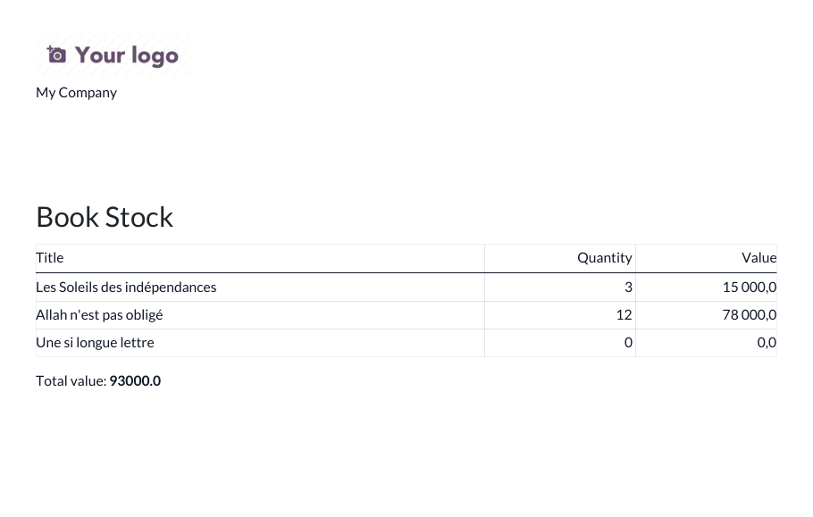

# Odoo 18 Snippets

🇫🇷 [Français](#français) · 🇬🇧 [English](#english)

## Français

Une antisèche commentée en français des briques de code Odoo 18 les plus utilisées.
Tous les exemples vivent dans le module installable `odoo_snippets_demo` (un petit catalogue de livres), couvert par des tests qui prouvent qu'ils fonctionnent.

### Sommaire

| # | Exemple | Fichier |
|---|---|---|
| 1 | Champ calculé **stocké** (`store=True`) | [models/book.py#L24](odoo_snippets_demo/models/book.py#L24) |
| 2 | Champ calculé **non stocké** | [models/book.py#L29](odoo_snippets_demo/models/book.py#L29) |
| 3 | Onchange avec avertissement | [models/book.py#L79](odoo_snippets_demo/models/book.py#L79) |
| 4 | Contrainte **Python** (`@api.constrains`) | [models/book.py#L96](odoo_snippets_demo/models/book.py#L96) |
| 5 | Contraintes **SQL** (`_sql_constraints` ; `models.Constraint` en 19) | [models/book.py#L38](odoo_snippets_demo/models/book.py#L38) |
| 6 | Assistant (`TransientModel`) + action liée | [wizards/book_restock_wizard.py](odoo_snippets_demo/wizards/book_restock_wizard.py), [vue](odoo_snippets_demo/wizards/book_restock_wizard_views.xml) |
| 7 | Action planifiée (`ir.cron`) | [data/ir_cron.xml](odoo_snippets_demo/data/ir_cron.xml), [méthode](odoo_snippets_demo/models/book.py#L105) |
| 8 | Rapport QWeb PDF | [report/book_report.xml](odoo_snippets_demo/report/book_report.xml) |
| 9 | Héritage de vue (`inherit_id` + `xpath`) | [views/res_partner_views.xml](odoo_snippets_demo/views/res_partner_views.xml), [modèle](odoo_snippets_demo/models/res_partner.py) |
| 10 | Vues `<list>`, formulaire, recherche (`invisible` direct) | [views/book_views.xml](odoo_snippets_demo/views/book_views.xml) |
| 11 | API externe en **XML-RPC** | [scripts/xmlrpc_client.py](scripts/xmlrpc_client.py) |
| 12 | Tests de chaque exemple | [tests/test_snippets.py](odoo_snippets_demo/tests/test_snippets.py) |
| 13 | Recherche sur un champ calculé **non stocké** (`search=`) + filtres | [models/book.py#L60](odoo_snippets_demo/models/book.py#L60), [vue](odoo_snippets_demo/views/book_views.xml) |

### Prérequis

- Odoo 18 (Community ou Enterprise) ; seuls `base` et `web` sont requis
- Python 3 pour le script XML-RPC (bibliothèque standard uniquement)

### Installation

1. Copiez `odoo_snippets_demo` dans votre chemin d'addons.
2. Mettez à jour la liste des applications puis installez **Odoo Snippets Demo** (menu *Snippets*).
3. Optionnel : `ODOO_URL=http://localhost:8069 ODOO_DB=ma_base ODOO_USER=admin ODOO_PASSWORD=*** python scripts/xmlrpc_client.py`

Lancer les tests : `odoo -d test -i odoo_snippets_demo --test-enable --stop-after-init`

### Versions supportées

Cette branche : Odoo **18.0**. Autres branches : [`19.0`](https://github.com/Junmodeste/odoo-snippets/tree/19.0). Tests automatisés exécutés en CI sur Odoo 18 Community (image `odoo:18`, 18.0-20261102 en local) + `postgres:16`.

### Licence

[LGPL-3](LICENSE)

### Auteur

Koffi Modeste Junior — [@Junmodeste](https://github.com/Junmodeste)

## English

A commented cheat sheet (in French) of the most used Odoo 18 code patterns.
Every example lives in the installable `odoo_snippets_demo` module (a small book catalog), with tests proving they work.

### Contents

| # | Example | File |
|---|---|---|
| 1 | **Stored** computed field | [models/book.py#L24](odoo_snippets_demo/models/book.py#L24) |
| 2 | **Non-stored** computed field | [models/book.py#L29](odoo_snippets_demo/models/book.py#L29) |
| 3 | Onchange with warning | [models/book.py#L79](odoo_snippets_demo/models/book.py#L79) |
| 4 | **Python** constraint | [models/book.py#L96](odoo_snippets_demo/models/book.py#L96) |
| 5 | **SQL** constraints (`_sql_constraints`; `models.Constraint` in 19) | [models/book.py#L38](odoo_snippets_demo/models/book.py#L38) |
| 6 | Wizard (`TransientModel`) + bound action | [wizards/book_restock_wizard.py](odoo_snippets_demo/wizards/book_restock_wizard.py) |
| 7 | Scheduled action (`ir.cron`) | [data/ir_cron.xml](odoo_snippets_demo/data/ir_cron.xml) |
| 8 | QWeb PDF report | [report/book_report.xml](odoo_snippets_demo/report/book_report.xml) |
| 9 | View inheritance (`inherit_id` + `xpath`) | [views/res_partner_views.xml](odoo_snippets_demo/views/res_partner_views.xml) |
| 10 | `<list>`, form and search views | [views/book_views.xml](odoo_snippets_demo/views/book_views.xml) |
| 11 | External **XML-RPC** API | [scripts/xmlrpc_client.py](scripts/xmlrpc_client.py) |
| 12 | Tests for every example | [tests/test_snippets.py](odoo_snippets_demo/tests/test_snippets.py) |
| 13 | Searching a **non-stored** computed field (`search=`) + filters | [models/book.py#L60](odoo_snippets_demo/models/book.py#L60), [view](odoo_snippets_demo/views/book_views.xml) |

### Requirements

- Odoo 18 (Community or Enterprise); only `base` and `web` are required
- Python 3 for the XML-RPC script (standard library only)

### Installation

1. Copy `odoo_snippets_demo` into your addons path.
2. Update the apps list and install **Odoo Snippets Demo** (*Snippets* menu).
3. Optional: `ODOO_URL=http://localhost:8069 ODOO_DB=my_db ODOO_USER=admin ODOO_PASSWORD=*** python scripts/xmlrpc_client.py`

### Supported versions

This branch: Odoo **18.0**. Other branches: [`19.0`](https://github.com/Junmodeste/odoo-snippets/tree/19.0). Automated tests run in CI on Odoo 18 Community (`odoo:18` image, 18.0-20261102 locally) + `postgres:16`.

### License

[LGPL-3](LICENSE)

### Author

Koffi Modeste Junior — [@Junmodeste](https://github.com/Junmodeste)
